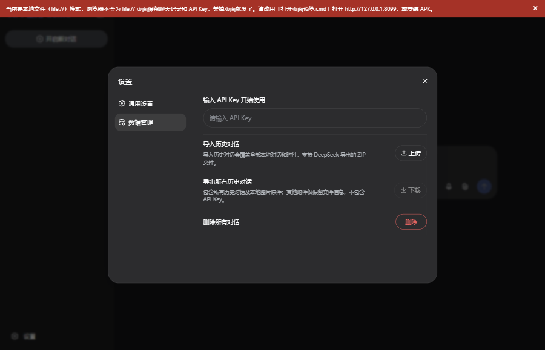
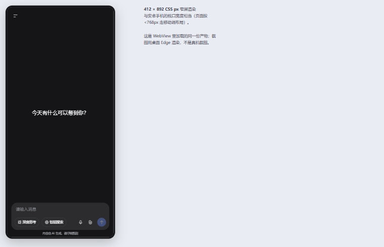
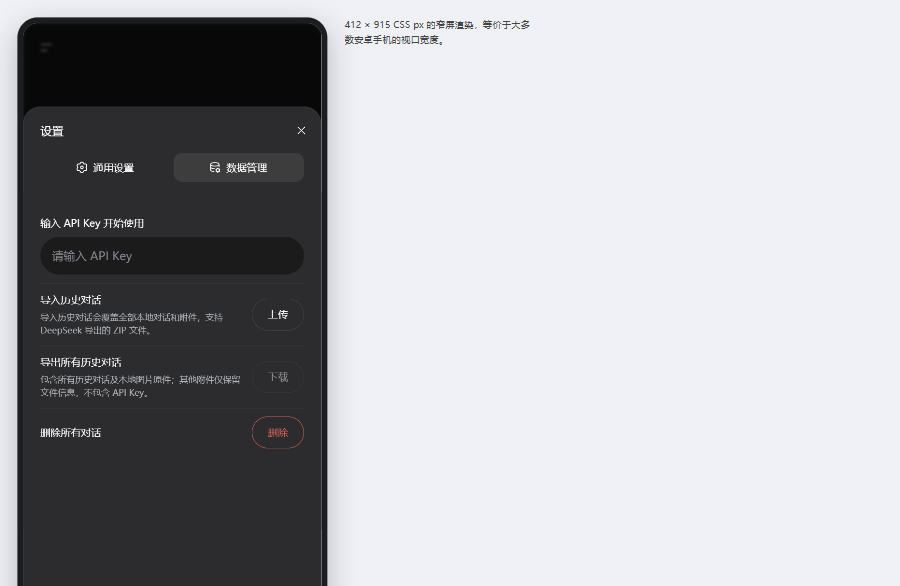
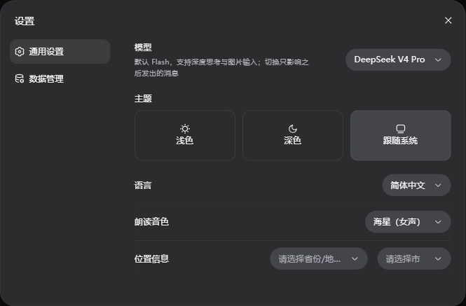
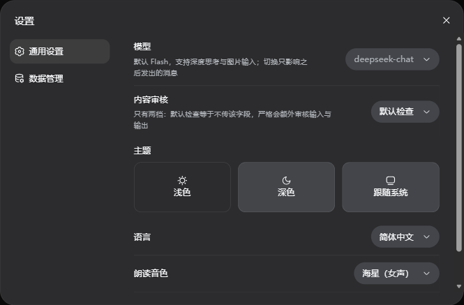
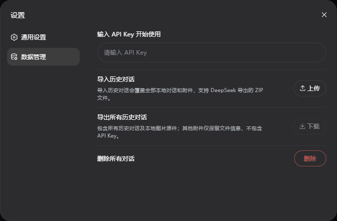

# Text API Channel（Android 外壳版 chat-demo）

> ⚠️ **非官方项目**：本项目与 DeepSeek（杭州深度求索）**没有任何隶属、合作或背书关系**，
> 仅调用用户自己填写的 API Key 与兼容接口通信，不提供任何 API 额度或代理服务。
> 使用前请务必阅读 [**免责声明 DISCLAIMER.md**](DISCLAIMER.md) —— 使用本项目即视为同意其全部条款。
>
> 许可证：[MIT](LICENSE)（外壳部分）｜前端产物来自 [DeepSeek chat-demo](https://github.com/deepseek-ai/chat-demo)（MIT，见 [third_party/](third_party/README.md)）

把 DeepSeek 开源的 [`chat-demo`](https://github.com/deepseek-ai/chat-demo)（React 18 + rspack 写的 Web 版
API 对话 demo，MIT 许可）装进一个 Android 外壳里，做成能直接装到手机上的 APK。

外壳只做三件事：**托管前端静态资源**、**补齐 WebView 缺少的能力**、**让系统外观跟着页面走**。
业务逻辑仍是上游原样，只在上游前端源码里打了很小一组补丁（见下方「前端改动清单」），
其余适配都在 `assets/native/native.js` 和 `MainActivity` / `NativeBridge` 里。

## 关于本项目（请先读这段）

**这是一个「想给自己手机上装个 AI 聊天 App」而顺带做出来的项目，不是一个专业软件工程作品。**

- 项目的前端改造与 Android 外壳，是在 **DeepSeek Harness（AI 辅助开发环境）** 的帮助下完成的：
  需求拆解、代码编写、排错大多由 AI 协同产出，人工负责判断、试错和最终取舍。
- 作者**并非计算机专业**，Android / Gradle / WebView 这些是边做边学的。因此你在代码里可能会看到
  不够优雅的写法、偏长的方法、命名不统一，以及一处问题多种解法并存的痕迹。
- 项目**没有在真机上完整验证过**（详见下方「当前状态」与「已知限制」），部分依赖 Android 运行时的
  功能只做了代码级检查。
- 维护者**没有义务提供技术支持**，也不承诺持续更新 —— 这一点与
  [免责声明](DISCLAIMER.md) 第 4.2 条一致。
- 如果你是内行，看到明显错误、更地道的写法或安全隐患，**非常欢迎开 issue 或 PR 指正**。
  对「AI 写的代码」提出质疑完全合理，能被指出问题是这个项目最大的收益。

之所以把这些写在最前面，是希望你在使用或参考之前就知道它大概是什么水平的东西，
而不是装完才发现踩坑。

## 先看这里：怎么打开

| 入口 | 命令 / 动作 | 说明 |
| --- | --- | --- |
| 手机（推荐） | 装 `dist/app-debug.apk`，或自己 `.\scripts\build-apk.ps1` 打一个 | WebView 里跑前端产物，数据存在 App 自己的存储里 |
| 电脑浏览器（调试用） | `npx serve app/src/main/assets/www` 或任意静态服务器 | 前端产物已随仓库提供，直接指向 `assets/www` 即可。**用 `http://` 打开**，端口随意 |
| ❌ 不要用 | 直接双击 `assets/www/index.html` | `file://` 页面浏览器不给正常存数据，**关掉后 API Key 和聊天记录都会消失**（页面会用红条提示） |

> 早期版本仓库里还有一个 `打开页面预览.cmd` 用来起 8099 端口的本地服务，那只是原作者本机的习惯，
> 没有一并开源 —— 用任意静态服务器替代即可，效果相同。

这个 demo **没有账号登录**：它不会让你输手机号/扫码，只认 API Key。
去 <https://platform.deepseek.com/api_keys> 建一个 `sk-` 开头的 Key，第一次打开时粘到「设置 → 输入 API Key」里。
Key **只有在 `/models` 校验通过后才会存下**（`useApiKeyForm.ts` 里先 `verifyApiKey` 再 `setApiKey`），
所以如果校验失败（欠费、Key 抄错、断网），关掉再打开会看到输入框又是空的 —— 这是上游设计，不是外壳的锅。

用错入口时页面会这样警告（`file://` 双击 `index.html` 的效果）：



| 欢迎页（412 px 窄屏） | 设置 → 数据管理 |
| --- | --- |
|  |  |

```
chat-demo-android/
├── app/src/main/
│   ├── java/io/github/zjh2000ic/textapichannel/
│   │   ├── MainActivity.java      # 单 Activity + WebView：文件选择、录音授权、下载、返回键
│   │   ├── NativeBridge.java      # JS 桥：保存文件、预览附件、同步状态栏
│   │   └── BuildConfigCompat.java # 版本号常量
│   ├── assets/
│   │   ├── native/native.js       # 注入页面的适配脚本（download / window.open / theme-color）
│   │   └── www/                   # chat-demo 的构建产物（由 scripts/sync-web.mjs 生成）
│   ├── res/                       # 主题、颜色、图标（品牌色 #3964FE）
│   └── AndroidManifest.xml
├── scripts/
│   ├── sync-web.mjs               # 同步 dist → assets/www，并给 index.html 打补丁
│   ├── web-shell.js               # 环境自检：file:// 或存储不可用时在页面顶部弹红条
│   ├── gen_icons.py               # 生成 mipmap 图标
│   └── build-apk.ps1              # 调 gradle 出 APK
└── docs/                          # 预览截图
```

## 已实现

| 能力 | 做法 |
| --- | --- |
| 页面来源 | `WebViewAssetLoader` 把 `assets/www` 映射到 `https://appassets.androidplatform.net`。**不能用 `file://`**，否则 `localStorage` / `IndexedDB` / `getUserMedia` 都没有安全上下文 |
| 对话、流式输出、会话历史 | 前端原样工作；IndexedDB 存在 WebView 里，卸载即清空 |
| API Key / 设置 | 仍由前端存在 `localStorage`，没有额外改造成原生存储 |
| 附件上传 | `onShowFileChooser` → `ACTION_GET_CONTENT`，支持多选 |
| 语音输入 | `onPermissionRequest` 动态申请 `RECORD_AUDIO`，授权后交给 `getUserMedia`（需 https 安全上下文，已满足） |
| 导出对话 / 下载附件 | 页面用的是 `blob:` + `a.click()`，WebView 不会触发下载。`native.js` 改写 `HTMLAnchorElement.prototype.click`，转成 base64 交给 `NativeBridge.saveFile`，Android 10+ 走 MediaStore 存进「下载」目录 |
| 附件预览 | `window.open(blob:)` 被拦下，写到缓存目录 + FileProvider，交给系统应用打开 |
| 外链 / 引用来源 | 非 `appassets` 的链接一律交给系统浏览器 |
| 状态栏配色 | 监听 `<meta name="theme-color">` 变化，同步状态栏/导航栏底色并切换图标明暗 |
| 返回键 | 先让页面关弹层，再按「再按一次退出」 |

## 构建

前置：JDK 17、Android SDK（`platforms;android-34` + `build-tools;34.0.0`）。
仓库带 Gradle Wrapper，**不需要预装 Gradle**。

```bash
# 最省事：直接出 debug APK（前端产物 assets/www 已随仓库提供）
./gradlew assembleDebug          # Windows: .\gradlew.bat assembleDebug
# 产物：app/build/outputs/apk/debug/app-debug.apk
```

Windows 上也可以用项目自带的打包脚本（会顺带把 APK 复制到 `dist/`，并支持自动查找 `.toolchain/` 里的工具链）：

```powershell
.\scripts\build-apk.ps1
# 产物：dist\app-debug.apk
```

外网拉依赖较慢的话，可以自己配 `JAVA_HOME` / `ANDROID_HOME` 指向已装的工具链。

### 想改前端（进阶）

`assets/www/` 里是**已经构建好的前端产物**，只改原生外壳（`java/`、`res/`、`assets/native/`）不需要碰它。
如果要改前端逻辑，需要另外拿到上游 [chat-demo](https://github.com/deepseek-ai/chat-demo) 的源码：

```bash
# 1) 把上游源码 clone 到仓库同级目录，并应用 README「前端改动清单」里的补丁
git clone https://github.com/deepseek-ai/chat-demo.git ../chat-demo-src

# 2) 构建前端（Node 20+）
cd ../chat-demo-src/chat-demo-0.1.1
pnpm install && pnpm build

# 3) 同步回本工程（重写 assets/www，并给 index.html 打补丁）
cd -
node scripts/sync-web.mjs

# 4) 重新打包
./gradlew assembleDebug
```

> `scripts/sync-web.mjs` 默认从 `../chat-demo-src/chat-demo-0.1.1/dist` 取产物，
> 也可以用 `node scripts/sync-web.mjs <你的 dist 目录>` 显式指定。

### 换图标

图标是脚本生成的，别手改 `mipmap-*` 里的 PNG。脚本依赖 Pillow（`pip install pillow`）：

```bash
# 用你自己的图（黑底白字这类图效果最好）
python scripts/gen_icons.py --source "你的图.png" app/src/main/res
# 不给 --source 则生成内置的品牌色气泡占位图
python scripts/gen_icons.py app/src/main/res
```

脚本会把图里的内容抠出来（黑底按亮度转成透明），生成三套 PNG：`ic_launcher.png`（方）、
`ic_launcher_round.png`（圆）、`ic_launcher_foreground.png`（adaptive 前景，内容收在中间安全区）。
adaptive 的底色来自 `res/values/colors.xml` 的 `ic_launcher_background`，换深色图时要一起改。
改完重跑 `build-apk.ps1`。`scripts\preview_icons.py` 会拼一张 `dist\icon-preview.png` 供预览。

`build-apk.ps1` 会自动设置这几个容易踩坑的环境变量，手工调 gradle 时要自己设：

- `GRADLE_USER_HOME=.toolchain\gradle-home` —— 不设会报 `Failed to load native library 'native-platform.dll'`（默认的 `~/.gradle` 不可写）。
- `ANDROID_USER_HOME=.toolchain\android-user-home` —— 不设会报 `C:\Users\<你>\.android` 不可写。
  **不要同时设 `ANDROID_PREFS_ROOT`**，两者路径不一致时 AGP 会直接抛
  `Several environment variables ... contain different paths to the Android Preferences folder`。
- `TEMP` / `TMP` 指到工程内；`gradle.properties` 里关掉了 `org.gradle.vfs.watch`。

安装：

```powershell
& "$env:ANDROID_HOME\platform-tools\adb.exe" install -r dist\app-debug.apk
```

想在电脑上直接看前端效果（不走 Android）：把任意静态服务器指向 `app/src/main/assets/www` 即可，
例如：

```bash
npx serve app/src/main/assets/www        # 或 python -m http.server -d app/src/main/assets/www 8099
```

浏览器打开终端提示的地址（`http://localhost:<端口>`）。注意必须用 `http://`，不能直接双击 html 用 `file://`。

## 模型切换

上游只发 `deepseek-flash`（`src/services/chat/store.ts:36` 里写死）。这个魔改版加了设置项：

- 设置 → 通用设置 → **模型**，可选 `DeepSeek Flash`（默认）和 `DeepSeek V4 Pro`；
- 填了 API Key 后会额外用 `GET /models` 拉一份**当前账号可用**的模型（`src/services/api/client.ts`
  的 `listModels`），服务端以后加减模型不用重新打包；
- 最后一项是 **自定义模型 ID…**：可以手填任意名字（比如以前的 `deepseek-chat` / `deepseek-reasoner`）。
  服务端只认 `/models` 里列出的 ID 和 `claude*` 别名，其它名字会让请求直接 400 —— 报错会显示在那条
  回复里，改回正常模型即可；
- 选择存在 `localStorage` 的 `chat-demo:model`，下次打开仍在；
- 只影响**之后发出的消息**（含「重新生成」「编辑后重发」），已生成的回答保留各自的模型记录；
- 改动点：`src/services/settings.ts`（新增 `model` + `setModel`）、`src/services/chat/store.ts`
  的 `createReply()` 改成读设置、`src/i18n/{zh,en}.ts` 加文案、`src/components/settings/SettingsDialog.tsx`
  加 `ModelSetting`（含自定义 ID 弹窗）。

> 上游 demo 开源时只有这两个模型；更老的 V3 / R1（`deepseek-chat` / `deepseek-reasoner`）在当前
> `GET /models` 里已经没有了，所以下拉里不会再出现它们——想试就填到「自定义模型 ID」。



## 内容审核（safety_check）

`POST /messages` 的 `safety_check.level` **只有 `low` 和 `high` 两个合法取值**，没有 0 / off：

| 取值 | 行为 |
| --- | --- |
| `low` | 默认检查，文档里的说法是「与不传该字段相同」 |
| `high` | 额外开启输入输出审核（会多出 `usage.output_tokens_details.safety_tokens` 计费） |

上游写死 `{ level: 'high' }`；这个魔改版把它改成设置项，**默认 `low`**，需要更严时再切回 `high`：
设置 → 通用设置 → **内容审核**（`chat-demo:safety`）。改动点：`src/services/settings.ts`（`safety` +
`setSafety`）、`src/services/chat/store.ts` 的 `streamReply()` 里 `safety_check: { level: safetyLevel }`。

服务端本身仍有基础风控：被拦时 `stop_reason` 是 `refusal`，前端改提示词或档位都绕不过去。



## 数据存在哪（排查「记录没了」时看这里）

| 数据 | 存储位置 | 代码 |
| --- | --- | --- |
| API Key、模型、语言、主题、思考/搜索开关 | `localStorage`，键前缀 `chat-demo:` | `src/services/settings.ts`（读写都吞异常，静默降级） |
| 会话列表、消息、附件 blob | `IndexedDB`，库 `chat-demo` 版本 11，5 个 store | `src/services/chat/db.ts:57` |

浏览器给每个源（origin）一套独立存储，所以 `file://`、`http://127.0.0.1:8099`、APK 里的
`https://appassets.androidplatform.net` 三个入口**互相看不到对方的记录**——在 file:// 里聊完再改用
8099 打开，看到的自然是空的。切入口前请先用「设置 → 数据管理 → 导出所有历史对话」导出，
换到新入口再「上传」导入。



## 前端改动清单（相对上游 chat-demo）

| 需求 | 改动位置 | 说明 |
| --- | --- | --- |
| 应用名 | `src/i18n/zh.ts:14`、`src/i18n/en.ts:17` 的 `appName`；`src/index.html:7` 的 `<title>` | 显示成 `Text API Channel`（侧边栏左上 + 浏览器标签页） |
| 系统提示词 | `src/services/chat/store.ts:38` `const SYSTEM_PROMPT` | 由使用者自行改写，随主 JS 打进包里 |
| 模型选择 | `src/services/settings.ts`（`model`/`setModel`，键 `chat-demo:model`）、`src/components/settings/SettingsDialog.tsx`（`ModelSetting`）、`src/services/chat/store.ts`（`createReply` 读设置） | 预设两项 + `GET /models` 动态拉取 + 自定义模型 ID |
| 内容审核档位 | `src/services/settings.ts`（`safety`/`setSafety`，键 `chat-demo:safety`）、`SettingsDialog.tsx`（`SafetySetting`）、`store.ts`（`streamReply` 里 `safety_check: { level }`） | 只有 `low`/`high` 两档，默认 `low` |

改完任何一项都要重走：`rspack build` → `node scripts/sync-web.mjs` → `scripts/build-apk.ps1`。

## 当前状态（已验证 / 未验证）

已验证：

- `assembleDebug` 构建成功，产物 `dist/app-debug.apk`（4.2 MB）。
- `aapt2 badging`：`io.github.zjh2000ic.textapichannel.debug`、`minSdk 24`、`targetSdk 34`、`compileSdk 34`、
  标签 `Text API Channel`、权限 `INTERNET` / `RECORD_AUDIO` / `MODIFY_AUDIO_SETTINGS`。
- `apksigner verify`：v2 签名有效（debug keystore）。
- APK 内含 `assets/www/index.html`、`assets/native/native.js`、3 个 dex。
- 前端产物在窄屏（412 × 892）下渲染正常，见上方截图：欢迎页、设置对话框、
  「深度思考 / 智能搜索 / 语音输入 / 上传文件」工具栏都在。
- 环境自检脚本：`file://` 打开时页面顶部出现红条提示（已截图确认），`http://127.0.0.1:8099`
  打开时不出现；预先写入 `chat-demo:api-key` 后打开 8099，应用能读回该 Key（设置对话框不再自动弹出），
  说明 http 源下的 `localStorage` 读写链路正常。
- 模型切换：设置里 `DeepSeek Flash` / `DeepSeek V4 Pro` 下拉可正常展开、选择，刷新页面后仍是
  刚选的那一项（存在 `chat-demo:model`）；`tsc --noEmit` 无类型错误。
- 自定义模型 ID：下拉里的「自定义模型 ID…」会弹出输入框，填入 `deepseek-chat` 后下拉直接显示该 ID，
  刷新页面后依然保留（也走 `chat-demo:model`）。
- 内容审核档位：设置里「内容审核」可在 `默认检查` / `严格` 之间切换，默认 `默认检查`，
  保存在 `chat-demo:safety`；请求体里对应 `safety_check.level`。
- 应用名：APK 标签（`application-label:'Text API Channel'`，全语言一致）、侧边栏标题、
  页面 `<title>` 都是 `Text API Channel`，见 `docs/07-app-name.png`。
- 图标：`res/mipmap-*/ic_launcher*.png` 由 `scripts/gen_icons.py --source "art/我画的.png"`
  生成（黑底手写 `Text API Channel`），`ic_launcher_background` 同步为纯黑。

未验证：

- **没有真机 / 模拟器跑过**。本机没有设备，且 `adb` 需要写 `C:\Users\<你>\.android`，
  在沙箱里被拒。所以以下这些依赖 Android 运行时的行为只做了代码级检查，没有实测：
  文件选择器回传、录音授权、导出/下载落盘、返回键退出、状态栏配色。
- Release 包没签名（`assembleRelease` 出的是未签名 APK）。

## 手机上一打开就闪退？先看这里

`0.1.2-diag`（versionCode 2）这一版专门为"点开就闪退"加了兜底（之后的版本都保留，
当前版本号见 `app/build.gradle.kts`）：

- 启动时**先挂一个纯色占位视图**，再在下一帧构造 WebView。构造失败（手机端最常见的原因是
  「Android System WebView」被禁用 / 缺失 / 太旧）不会再把进程直接带崩，而是显示一屏
  **「启动失败」**：机型、Android 版本、包名、WebView 包名与版本、完整堆栈，下面还有
  「复制 / 重试 / 退出」三个按钮。把这一屏截图发我就能定位。
- 任何未捕获异常也会写一份到应用私有目录
  `Android/data/io.github.zjh2000ic.textapichannel.debug/files/crash-*.txt`。
- 顺手加了一个前置检查：`WebView.getCurrentWebViewPackage() == null` 时直接给出可读提示
  （"请在应用商店更新 Android System WebView 或 Chrome，重新启用后再试"）。

如果装上 `0.1.2-diag` 之后**仍然瞬间闪退**（连白色占位屏都看不到），那说明崩溃发生在
`onCreate` 之前，范围就缩小到三种：主题/资源解析、`FileProvider` 实例化、类加载。
这种情况下需要 logcat：

```powershell
# 手机开「开发者选项 → USB 调试」，连上电脑后
adb logcat -d -b crash | Select-String "AndroidRuntime" -Context 0,25
```

## 已知限制 / 后续可以做的

- **包名是 `io.github.zjh2000ic.textapichannel`**（debug 包多一个 `.debug` 后缀，可与正式包共存）：
  有意不使用官方包名，避免与任何官方应用冲突；如需分发请换成你自己拥有的域名倒写，并配置自己的签名。
- **改包名（`applicationId`）会导致旧数据不可用**：早期版本用过 `com.example.chatdemo`，
  两者在系统里是两个独立 App，新版无法覆盖安装、也读不到旧版的 `localStorage` / `IndexedDB`。
  升级前请先在旧版里「设置 → 数据管理 → 导出所有历史对话」，装新版后再导入，最后卸载旧版。
- **API Key 存在 WebView 的 localStorage**：等同浏览器，没有 Keystore 加密。要更安全就挪到
  `EncryptedSharedPreferences`，在桥里改写请求头。
- **语音朗读**用 `AudioContext` 播 API 返回的 PCM，首次可能需要一次用户手势才出声。
- **深色模式**：原生窗口底色跟随系统主题，页面内主题仍由 demo 自己的设置控制，两边可能短暂不同步。
- **没做 edge-to-edge**：靠 `adjustResize` + 状态栏设色，刘海 / 手势条区域交给系统。
- **`file://` 不支持**：直接双击 `assets/www/index.html` 能看界面，但浏览器不给 file:// 页面可靠的持久存储
  （实测该 origin 的 IndexedDB 里只有建库记录、没有任何会话数据），所以页面顶部会用红条提示改用
  http 静态服务或 APK。红条由 `scripts/web-shell.js` 注入，只在环境有问题时出现。
- **前端只打了「前端改动清单」里那几处补丁**，任何 Web 端的改动都要重走「构建前端 → sync-web → build-apk」。

## 许可证与免责

| 文件 | 用途 |
| --- | --- |
| [LICENSE](LICENSE) | 本仓库 Android 外壳部分（`app/src/main/java/`、`scripts/`、`res/` 等）—— MIT，Copyright (c) 2026 zjh2000ic |
| [third_party/chat-demo/LICENSE](third_party/chat-demo/LICENSE) | 上游 [DeepSeek chat-demo](https://github.com/deepseek-ai/chat-demo) 的 MIT 原文，适用于 `assets/www/` 内的前端产物 |
| `assets/www/LICENSE` | 同上，随 APK 一起分发（MIT 要求声明随副本走） |
| [DISCLAIMER.md](DISCLAIMER.md) | 免责声明 —— **使用本项目即视为同意其全部条款** |

前端来自 DeepSeek 的 chat-demo，MIT 许可；本仓库的 Android 外壳部分同样按 MIT 使用。
再分发（含打包成 APK 分享）时，请同时保留上述两份版权与许可声明，以及 `DISCLAIMER.md`。

本项目为**非官方**第三方客户端，与 DeepSeek 无隶属关系，详见 [DISCLAIMER.md](DISCLAIMER.md)。
